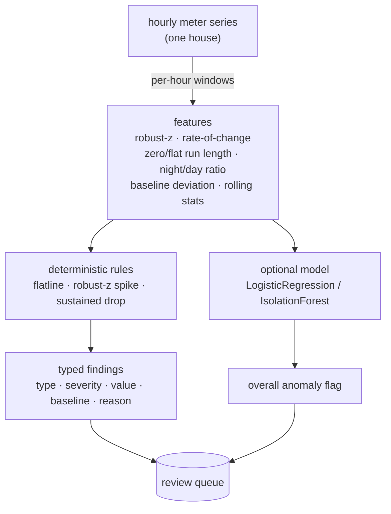

# GridGuard

Offline, explainable anomaly detection for smart-meter / grid time series. Given
a house's hourly electricity readings, GridGuard flags three operational
problems and explains every flag: **consumption spikes**, **outages / flatlines**
(a dead or stuck meter), and **non-technical loss** — meter tampering or
electricity theft. The detector is deterministic and fully offline; an optional
learned model sits on top as a second opinion, and the whole thing is evaluated
honestly on meters it has never seen.

[](.github/workflows/ci.yml)
[](pyproject.toml)
[](LICENSE)

---

## Why it matters

Grid operators drown in meter data and cannot eyeball it. The useful question is
not "is this reading high?" but "is this reading unusual *for this meter, at this
hour of this day*, and if so why?". A lot of "AI for the grid" answers that with
an opaque score. GridGuard answers it with a **reason**:

- a spike is reported as *how many robust standard deviations above this meter's
  own baseline* it is,
- an outage as *how many consecutive hours the meter has been flat or at zero*,
- theft as *how far below the expected load the meter has been held, for how
  long* — and whether the readings went negative (a classic bypass).

Each flag names the rule that fired, the offending value, the meter's own
baseline, and a severity, so an analyst can act on it or dismiss it.

## How it works



1. **Generator (`generate.py`).** Synthesises hourly series for many houses from
   a residential shape (daily + weekly seasonality) plus multiplicative noise,
   then injects **labelled** anomalies: spikes, outages/flatlines, and
   theft/tampering. It also injects the occasional legitimate **vacation** (a
   sustained drop that is *not* theft) on purpose, so the evaluation cannot cheat.
2. **Features (`features.py`).** Per hour, a small, **scale-free** feature vector:
   the robust z-score of the reading against the meter's own seasonal baseline,
   rate-of-change, zero- and flat-run lengths, a night-vs-day ratio, the signed
   deviation from baseline, and rolling mean/std. Scale-free so a model trained on
   some houses transfers to houses of a different size.
3. **Detector (`detector.py`).** Deterministic rules produce the typed,
   explainable findings. The baseline each rule compares against is the meter's
   own per-(weekend, hour) **median** — robust, so an anomaly does not corrupt
   the baseline it is measured against (see ADR 0004). An **optional**
   scikit-learn model (`logistic` by default) adds an overall anomaly flag.
4. **Evaluation (`evaluation.py`).** Held-out, per-type, point-wise, averaged over
   seeds — see below.

## Quick start

```bash
python -m venv .venv && source .venv/bin/activate
pip install -e ".[dev]"

python -m gridguard.cli demo          # simulate meters, inject one of each anomaly, explain the flags
python -m gridguard.evaluation        # honest held-out precision/recall/F1 per type
uvicorn gridguard.main:app --reload   # HTTP API
```

Example API call:

```bash
# POST a series of hourly readings; get back explained findings.
curl -s -X POST localhost:8000/detect -H 'content-type: application/json' \
  -d '{"readings": [1.2, 0.9, 0.8, 0.8, 1.0, 1.4, 2.1, 0.0, 0.0, 0.0, 0.0, 0.0, 0.0]}'

curl -s localhost:8000/health
```

## Configuration

Settings load from environment variables with the `GG_` prefix (see
`.env.example`):

| Variable               | Default    | Meaning                                                         |
| ---------------------- | ---------- | --------------------------------------------------------------- |
| `GG_SPIKE_Z_THRESHOLD` | `5.0`      | Robust z above which an hour is a consumption spike             |
| `GG_SPIKE_MIN_REL`     | `1.0`      | A spike must also be at least this fraction above baseline (2x) |
| `GG_FLATLINE_MIN_RUN`  | `6`        | Min zero/constant run (hours) for an outage or stuck meter      |
| `GG_THEFT_FRACTION`    | `0.6`      | A reading below this fraction of baseline is a possible drop    |
| `GG_THEFT_MIN_RUN`     | `12`       | Min sustained-drop run (hours) before flagging theft            |
| `GG_MODEL_KIND`        | `logistic` | Learned layer: `logistic`, `isolation_forest`, or `none`        |
| `GG_ROLLING_WINDOW`    | `24`       | Rolling-window length (hours) for the windowed features         |

## Evaluation: honest, held out, and not pretending theft is solved

The data is synthetic *and labelled*, so we can measure detection properly
instead of reporting a flattering number. The evaluation (`python -m
gridguard.evaluation`) holds out **whole houses** — the test meters are never
seen in training — scores **per hour** against the true labels, reports
**precision / recall / F1 per anomaly type**, and averages over several seeds so
one lucky split cannot set the headline. Measured (mean over 5 seeds):

```
per anomaly type (deterministic rules)
  consumption_spike   precision 0.90  recall 1.00  f1 0.95
  outage_flatline     precision 0.93  recall 1.00  f1 0.96
  theft_tampering     precision 0.63  recall 0.46  f1 0.53

overall any-anomaly (per hour)
  rules only          precision 0.77  recall 0.64  f1 0.69
  model only          precision 0.60  recall 0.89  f1 0.72
  rules + model       precision 0.61  recall 0.93  f1 0.73
```

What these numbers do and do **not** claim, stated plainly:

- **Spikes and outages are easy and the detector is good at them** (F1 ~0.95).
  A sharp multi-sigma jump and a long flat run are unambiguous.
- **Theft is genuinely hard, and the score says so.** A subtle, sustained drop
  to ~70% of normal is nearly indistinguishable from legitimate low use — and
  the generator deliberately injects **vacations** (real low-use periods labelled
  *normal*), so the theft rule honestly produces false positives against them.
  Recall ~0.46 means the deterministic rule catches the blatant cases (deep or
  negative/bypassed readings) and misses the subtle ones. Reporting ~0.46 rather
  than burying theft inside one headline number is the honest thing to do.
- **The learned model is a useful second opinion, not magic.** On unseen meters
  it lifts overall recall from 0.64 (rules) to 0.93 (rules + model), at a
  precision cost (0.77 → 0.61). That trade is the operator's to make.

The honest baseline to beat is this held-out, per-type score — **not** a
within-distribution ~1.0, which synthetic data would happily hand you.

## Testing

```bash
ruff check gridguard tests
pytest --cov=gridguard --cov-report=term-missing --cov-fail-under=80
```

The suite covers feature correctness (robust-z, seasonal baseline, run lengths),
the detection of each anomaly type, a clean series raising **no** false alarms,
the minimum-run thresholds (a too-short outage is ignored), the honest-eval
floors (conservative, taken from measured values), the HTTP API, and the CLI
demo.

## Documentation

- `docs/architecture.md` — components, data flow, and the design rationale.
- `docs/adr/` — the main design decisions and their trade-offs.
- `docs/estudio/` — a study guide in Spanish, for learning the project in depth.

## A note on scope

GridGuard is a reference implementation, not a production AMI analytics platform.
It runs entirely offline on **synthetic** data with known labels. A real
deployment would ingest real smart-meter (AMI) streams, train and threshold
against **real labels** (confirmed theft cases, outage tickets, maintenance
records), handle missing data and clock/DST issues, and re-evaluate under drift.
The point here is the method — explainable, deterministic detection measured
honestly — not the numbers, which only hold for this synthetic world.

## License

MIT. See [LICENSE](LICENSE).
