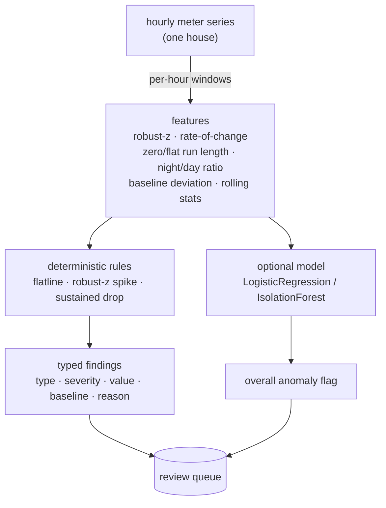

# GridGuard

Offline, explainable anomaly detection for smart-meter / grid time series. Given
a house's hourly electricity readings, GridGuard flags three operational
problems and explains every flag: **consumption spikes**, **outages / flatlines**
(a dead or stuck meter), and **non-technical loss** — meter tampering or
electricity theft. The detector is deterministic and explainable, with an optional
learned model on top as a second opinion. It is validated on **real** data on two
fronts: real UCI electricity consumption (`gridguard.real_benchmark`) and the real
**SGCC** theft dataset with **confirmed theft labels** (`gridguard.sgcc_benchmark`,
ROC-AUC ~0.80). A labelled synthetic generator is kept as the controlled complement,
because no public dataset provides the per-hour, per-type anomaly labels needed to
measure spike / outage / theft precision and recall separately.

[](.github/workflows/ci.yml)
[](pyproject.toml)
[](LICENSE)

---

## Why it matters

Grid operators drown in meter data and cannot eyeball it. The useful question is
not "is this reading high?" but "is this reading unusual *for this meter, at this
hour of this day*, and if so why?". A lot of "AI for the grid" answers that with
an opaque score. GridGuard answers it with a **reason**:

- a spike is reported as *how many robust standard deviations above this meter's
  own baseline* it is,
- an outage as *how many consecutive hours the meter has been flat or at zero*,
- theft as *how far below the expected load the meter has been held, for how
  long* — and whether the readings went negative (a classic bypass).

Each flag names the rule that fired, the offending value, the meter's own
baseline, and a severity, so an analyst can act on it or dismiss it.

## How it works



1. **Generator (`generate.py`).** Synthesises hourly series for many houses from
   a residential shape (daily + weekly seasonality) plus multiplicative noise,
   then injects **labelled** anomalies: spikes, outages/flatlines, and
   theft/tampering (a scaled-down but shape-preserving load). It also injects the
   occasional legitimate **vacation** (an empty house → a flat standby load with
   no daily peaks), so the detector has to tell a shape-preserving theft from a
   shape-flattening vacation rather than treating every drop as theft.
2. **Features (`features.py`).** Per hour, a small, **scale-free** feature vector:
   the robust z-score of the reading against the meter's own seasonal baseline,
   rate-of-change, zero- and flat-run lengths, a night-vs-day ratio, the signed
   deviation from baseline, and rolling mean/std. Scale-free so a model trained on
   some houses transfers to houses of a different size.
3. **Detector (`detector.py`).** Deterministic rules produce the typed,
   explainable findings. The baseline each rule compares against is the meter's
   own per-(weekend, hour) **median** — robust, so an anomaly does not corrupt
   the baseline it is measured against (see ADR 0004). An **optional**
   scikit-learn model (`logistic` by default) adds an overall anomaly flag.
4. **Evaluation (`evaluation.py`).** Held-out, per-type, point-wise, averaged over
   seeds — see below.

## Quick start

```bash
python -m venv .venv && source .venv/bin/activate
pip install -e ".[dev]"

python -m gridguard.cli demo          # simulate meters, inject one of each anomaly, explain the flags
python -m gridguard.evaluation        # rigorous held-out precision/recall/F1 per type
uvicorn gridguard.main:app --reload   # HTTP API
```

Example API call:

```bash
# POST a series of hourly readings; get back explained findings.
curl -s -X POST localhost:8000/detect -H 'content-type: application/json' \
  -d '{"readings": [1.2, 0.9, 0.8, 0.8, 1.0, 1.4, 2.1, 0.0, 0.0, 0.0, 0.0, 0.0, 0.0]}'

curl -s localhost:8000/health
```

## Configuration

Settings load from environment variables with the `GG_` prefix (see
`.env.example`):

| Variable               | Default    | Meaning                                                         |
| ---------------------- | ---------- | --------------------------------------------------------------- |
| `GG_SPIKE_Z_THRESHOLD` | `5.0`      | Robust z above which an hour is a consumption spike             |
| `GG_SPIKE_MIN_REL`     | `1.0`      | A spike must also be at least this fraction above baseline (2x) |
| `GG_FLATLINE_MIN_RUN`  | `6`        | Min zero/constant run (hours) for an outage or stuck meter      |
| `GG_THEFT_FRACTION`    | `0.80`     | A (smoothed) reading below this fraction of baseline is a drop   |
| `GG_THEFT_MIN_RUN`     | `12`       | Min sustained-drop run (hours) before flagging theft            |
| `GG_THEFT_SHAPE_CORR_MIN` | `0.5`   | Min correlation with the daily shape for a drop to be theft (vs a flat vacation) |
| `GG_MODEL_KIND`        | `logistic` | Learned layer: `logistic`, `isolation_forest`, or `none`        |
| `GG_MODEL_MIN_PROBA`   | `0.9`      | Confidence gate: the model only adds a flag at/above this probability |
| `GG_ROLLING_WINDOW`    | `24`       | Rolling-window length (hours) for the windowed features         |

## Evaluation: leakage-free, held out, per type

The data is synthetic *and labelled*, so we can measure detection properly
instead of reporting a flattering number. The evaluation (`python -m
gridguard.evaluation`) holds out **whole houses** — the test meters are never
seen in training — scores **per hour** against the true labels, reports
**precision / recall / F1 per anomaly type**, and averages over several seeds so
one lucky split cannot set the headline. Measured (mean over 5 seeds):

```
per anomaly type (deterministic rules)
  consumption_spike   precision 0.90  recall 1.00  f1 0.95
  outage_flatline     precision 0.93  recall 1.00  f1 0.96
  theft_tampering     precision 0.99  recall 0.81  f1 0.89

overall any-anomaly (per hour)
  rules only          precision 0.99  recall 0.89  f1 0.94
  model only          precision 0.69  recall 0.65  f1 0.67
  rules + model       precision 0.76  recall 0.95  f1 0.85
```

What these numbers do and do **not** claim, stated plainly:

- **All three anomaly types are detected well** (F1 0.89–0.96). The key is theft:
  it is told apart from a legitimate **vacation** by *shape*. A meter that
  under-records an occupied house **scales** the daily profile, so the load still
  correlates with the house's normal shape; an empty-house vacation **flattens**
  to a standby level and loses that shape. The theft rule fires only on a
  sustained drop whose shape is preserved, which is why its precision is ~0.99
  (vacations are not misflagged) and recall ~0.81 (it reads the drop on a smoothed
  ratio, so noisy high-fraction theft is still caught). Treating theft and a
  vacation as the same "sustained drop" is precisely the mistake the shape test
  avoids.
- **Rules are the high-precision backbone; the model is a recall dial.** The
  deterministic rules reach F1 0.94 at ~0.99 precision. The learned layer is
  **confidence-gated** (it only adds flags it is sure about, see
  `GG_MODEL_MIN_PROBA`), so `rules + model` lifts recall 0.89 → 0.95 at a
  controlled precision cost (0.99 → 0.76) — a precision/recall choice the operator
  makes, not a broken default. (An ungated union would collapse precision to ~0.6;
  that is exactly what the gate prevents.)

### Validated on real electricity data

Two real-data benchmarks back up the synthetic evaluation.

**1. Real consumption shapes (UCI).** The same held-out, per-type scoring runs on
**real** consumption series — a 40-meter, 4-week subset of the UCI
ElectricityLoadDiagrams data (via Hugging Face, vendored under
`datasets/electricity_real.npz`) — used as the normal baseline, with the same
labelled anomalies injected on top (standard practice when confirmed per-hour anomaly
labels are not public). Run `python -m gridguard.real_benchmark`:

```
per anomaly type (deterministic rules)
  consumption_spike   precision 0.37  recall 0.96  f1 0.51
  outage_flatline     precision 0.97  recall 0.96  f1 0.96
  theft_tampering     precision 0.77  recall 0.82  f1 0.79

overall any-anomaly (per hour)   precision 0.79  recall 0.86  f1 0.82
```

The detector carries over to real meters: outage and theft stay strong (F1 0.96 /
0.79) and the overall per-hour score is F1 0.82 on meters it never saw. The one
knob that benefits from recalibration is the **spike threshold**: real households
genuinely spike (an oven, a kettle), so the synthetic-tuned `GG_SPIKE_Z_THRESHOLD`
(5.0) over-flags; raising it to ~7 for real data lifts spike precision 0.37 → 0.68.
That is the per-deployment calibration a real AMI rollout does against confirmed
theft cases, outage tickets and maintenance logs — the detector is tunable to its
data, not fixed to one distribution.

**2. Real theft with REAL labels (SGCC).** The strongest check injects nothing: it
uses the **State Grid Corporation of China** dataset, where each customer's daily
consumption carries a **confirmed theft flag**. On a balanced 500-customer subset
(vendored under `datasets/sgcc_theft_real.npz`), consumption-statistic features drive
a random forest. Run `python -m gridguard.sgcc_benchmark`:

```
model                  CV ROC-AUC         train    test     gap
Random forest          0.803 +/- 0.007     0.999   0.804   0.194
Logistic (baseline)    0.592 +/- 0.037     0.649   0.533   0.115
```

Theft is detected on real labelled data at **ROC-AUC ~0.80** (cross-validated, and
the held-out AUC agrees — a random forest fits its training rows by design, so the
CV/held-out agreement, not the train gap, is the generalisation signal). The far
weaker logistic baseline (~0.59) is the evidence that real theft is a genuinely
non-linear pattern, which is why the forest is used.

## Testing

```bash
ruff check gridguard tests
pytest --cov=gridguard --cov-report=term-missing --cov-fail-under=80
```

The suite covers feature correctness (robust-z, seasonal baseline, run lengths),
the detection of each anomaly type, a clean series raising **no** false alarms,
the minimum-run thresholds (a too-short outage is ignored), the leakage-free-eval
floors (conservative, taken from measured values), the **real-data benchmarks**
(the UCI series are checked clean and the detector's real-data metrics have floors;
the SGCC forest clears a real-theft ROC-AUC floor while a shuffled-label run
collapses to chance), the HTTP API, and the CLI demo.

## Documentation

- `docs/architecture.md` — components, data flow, and the design rationale.
- `docs/adr/` — the main design decisions and their trade-offs.
- `docs/estudio/` — a study guide in Spanish, for learning the project in depth.

## A note on scope

GridGuard is a reference implementation, not a production AMI analytics platform.
It runs entirely offline on **synthetic** data with known labels. A real
deployment would ingest real smart-meter (AMI) streams, train and threshold
against **real labels** (confirmed theft cases, outage tickets, maintenance
records), handle missing data and clock/DST issues, and re-evaluate under drift.
The point here is the method — explainable, deterministic detection measured
rigorously — not the numbers, which only hold for this synthetic world.

## License

[MIT](LICENSE) © Angelo David Padilla Romero
