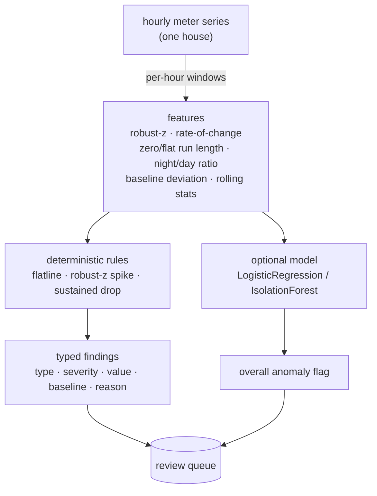

# Architecture

GridGuard is a small pipeline: a synthetic data generator, a feature layer, a
detector (deterministic rules plus an optional learned model), an honest
evaluation, and thin service/CLI/API surfaces. Everything is offline and
deterministic.

## Components

| Component   | File                     | Responsibility                                                   |
| ----------- | ------------------------ | ---------------------------------------------------------------- |
| Config      | `gridguard/config.py`    | Settings from `GG_`-prefixed environment variables               |
| Generator   | `gridguard/generate.py`  | Synthetic labelled meter series + whole-house train/test split   |
| Features    | `gridguard/features.py`  | Per-hour windowed features and the robust seasonal baseline      |
| Detector    | `gridguard/detector.py`  | Deterministic typed rules + optional learned anomaly model       |
| Evaluation  | `gridguard/evaluation.py`| Held-out, per-type, point-wise precision/recall/F1 over seeds    |
| Service     | `gridguard/service.py`   | Fits the model once, scores arbitrary series                     |
| HTTP API    | `gridguard/main.py`      | REST surface over the service                                    |
| CLI         | `gridguard/cli.py`       | End-to-end demo                                                  |

## Data flow

## The three anomaly types

- **Consumption spike** — a short, sharp jump far above the meter's usual level
  for that hour-of-week. Detected by a **robust z-score** (median + MAD) on the
  baseline deviation, gated by a minimum relative size so a single noisy hour on
  a very flat meter is not mistaken for a spike.
- **Outage / flatline** — a run of (near-)zero readings (a hard outage) or a run
  of perfectly constant readings (a stuck meter). Real consumption is never
  exactly flat for hours, so a long flat run is the signal.
- **Theft / non-technical loss** — readings held below a fraction of the expected
  load for a sustained stretch, or negative / near-zero "bypassed" readings. This
  is the hard case; see the evaluation note below.

The rules are applied in priority order per hour, so each hour gets at most one
type: negative/bypass first, then outage/flatline, then sustained drop, then
spike.

## Why the baseline is a robust per-meter median

Each meter is judged against **its own** expected profile, estimated as the
median reading in each (weekend?, hour-of-day) cell of its own series. Two
reasons it is a *median*, not a mean:

1. **Per-meter.** Houses differ in size and habits; a global baseline would flag
   a big house as a permanent anomaly. Estimating from the series itself needs no
   training and adapts to each meter.
2. **Robust.** Injected anomalies are a minority of any cell's samples, so the
   median ignores them. A mean baseline would be dragged toward the very
   anomalies we are trying to measure against (see ADR 0004).

## Why features are scale-free

The learned model is trained on some houses and applied to **unseen** ones, so
the features must not encode a house's absolute size. They are all ratios,
deviations, z-scores, or run lengths — a 5 kW house and a 0.5 kW house with the
same *shape* of problem produce the same feature values. This is what lets the
held-out evaluation be a real generalisation test rather than a memory test.

## Why the evaluation is held out, per-type, and seed-averaged

A random train/test split of synthetic data, scored as one number, would report
a meaningless near-perfect accuracy. Instead the evaluation:

- holds out **whole houses** (unseen meters at test time),
- scores **per hour** against the true labels (an outage flagged late still
  loses recall on the missed hours),
- reports **per anomaly type**, because spikes/outages are easy and theft is
  hard, and one blended number would hide that, and
- **averages over seeds**, so a lucky split cannot set the headline.

The result is honest: spikes and outages score ~0.95 F1, theft scores ~0.53, and
the learned model trades precision for recall overall. A production system would
re-run this against real AMI data and real labels.
